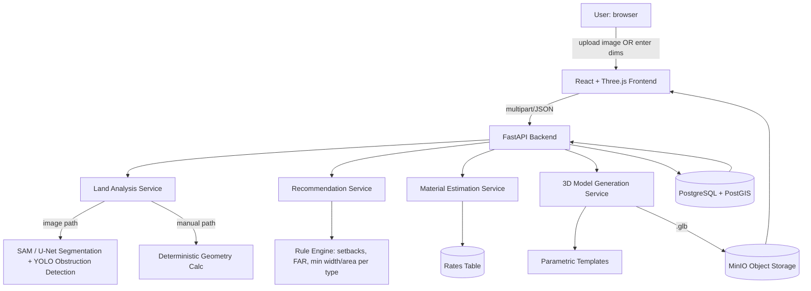

# Architecture Overview

## Notes for the report

- Land analysis has two paths (image / manual) that converge on the same
  `PlotAnalysisResult` schema — this lets you demo reliably even if the ML
  segmentation isn't perfectly trained by submission time.
- The recommendation and material-estimation services are intentionally
  deterministic/rule-based first. This is defensible in a viva ("why not
  pure ML here?") — construction quantity norms and zoning rules are
  standardized formulas, not something you want a black-box model
  guessing at when money and code-compliance are involved. ML augmentation
  (e.g. a learned re-ranker over the rule scores) is a good "future work"
  section.
- 3D generation is procedural/parametric, not generative-from-scratch —
  see the docstring in `model_generation_service.py` for the reasoning to
  reuse directly in your report's "design decisions" chapter.
